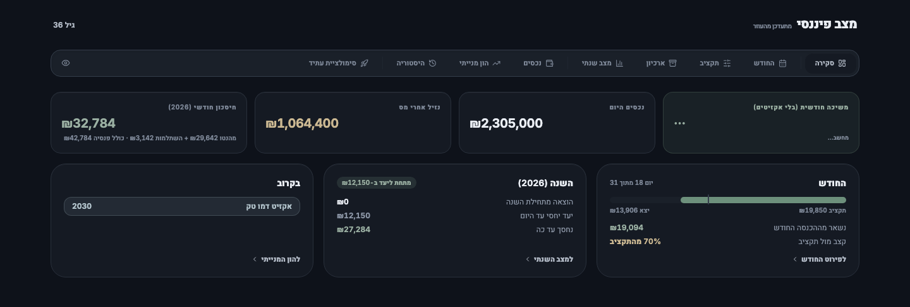
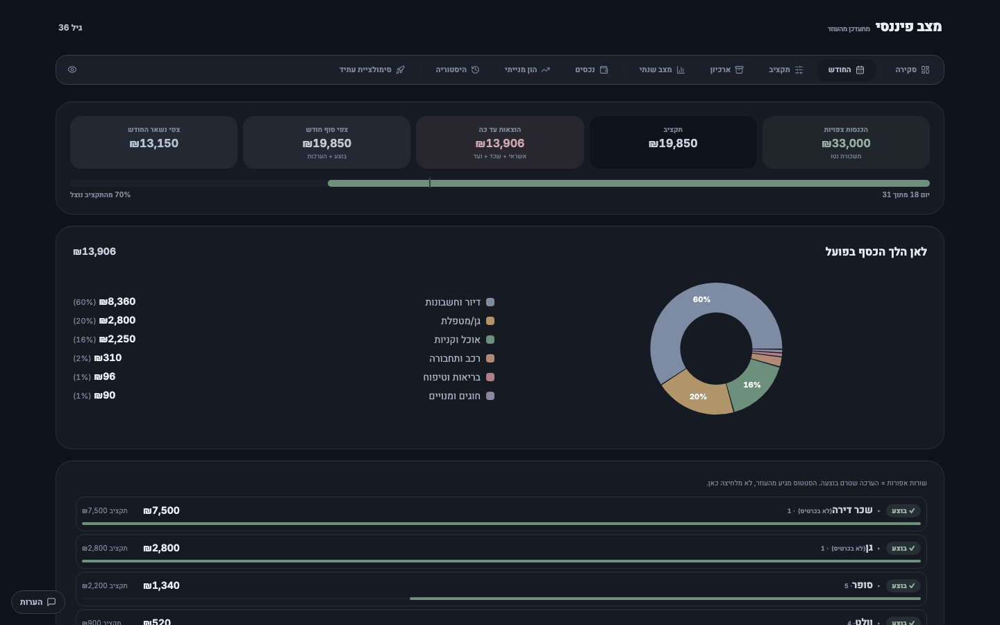
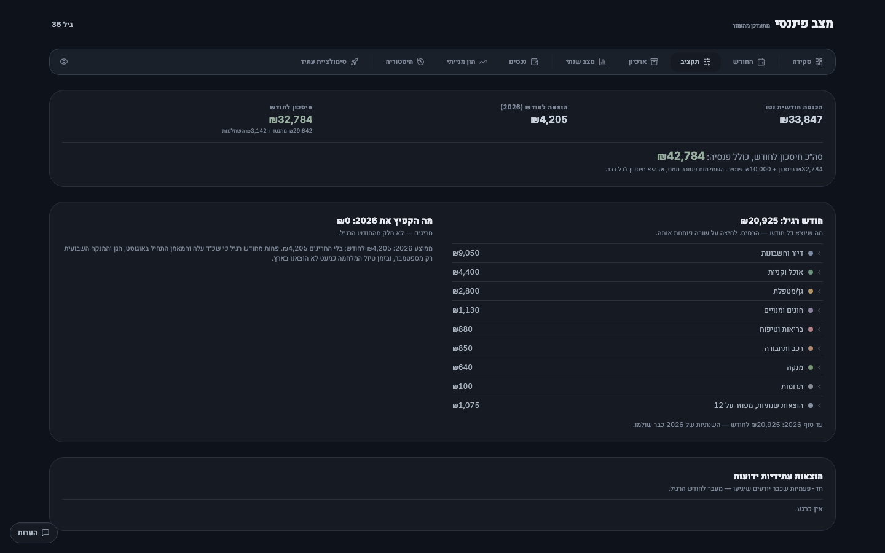
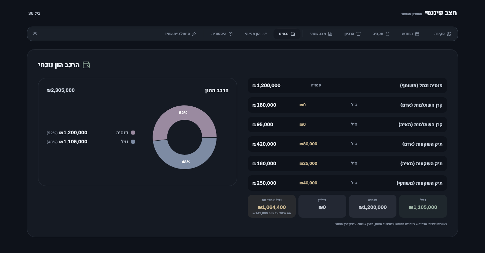
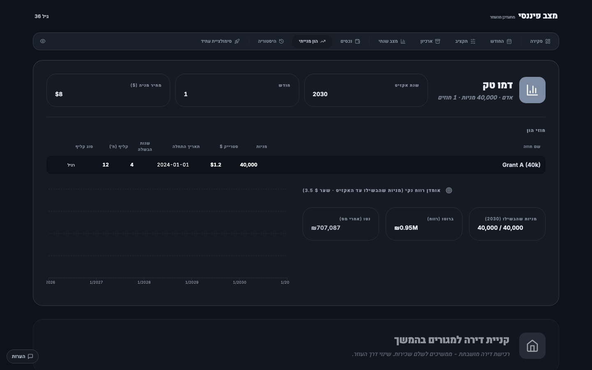
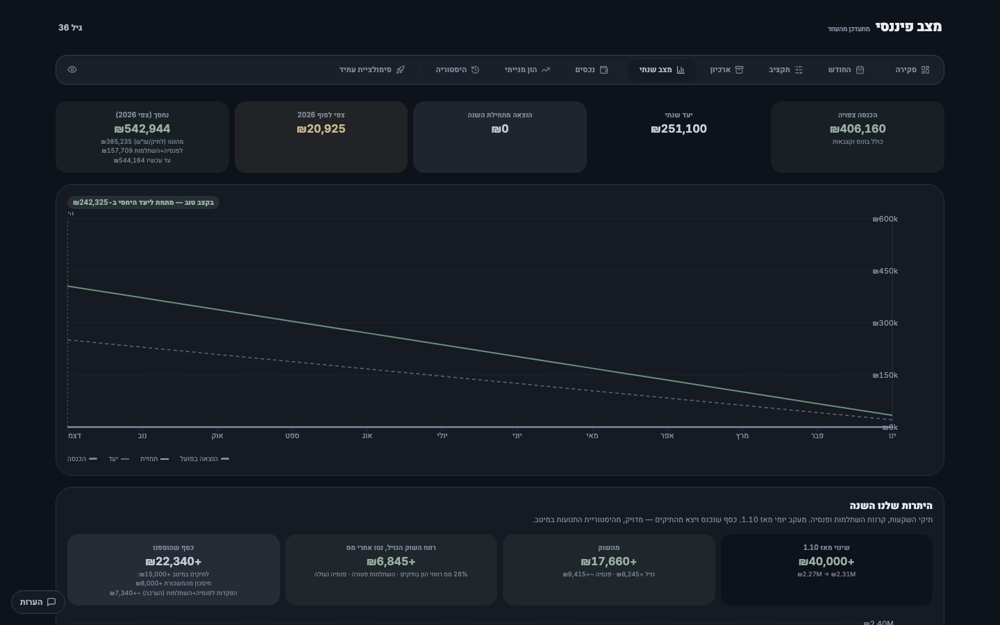
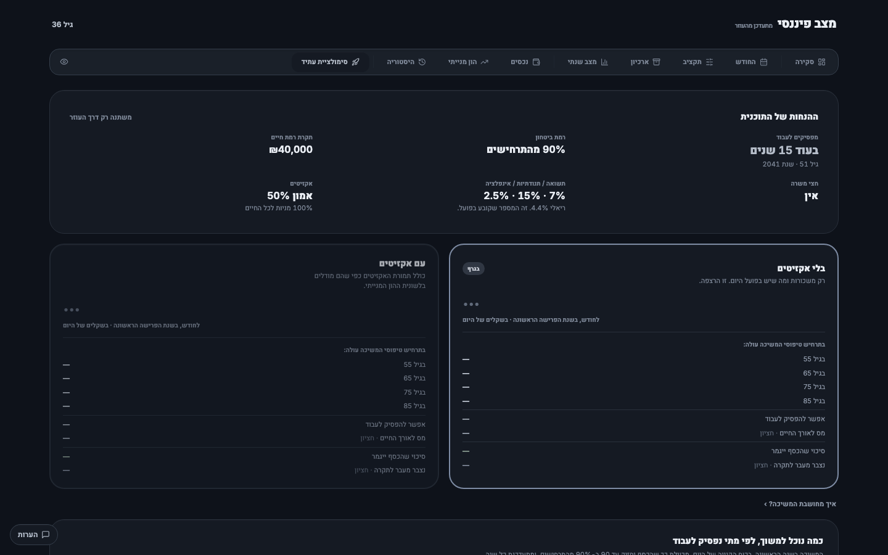

# מצב פיננסי

מסך לתמונת מצב של משק בית: הכנסה מול מה שיצא בפועל, פנסיה, תיק השקעות, והון מנייתי.

המסך הוא תצוגה. אין בו עריכה של שורות תקציב, נכסים, מענקים או סקנדרי. מי שעובד עם זה לא משנה מספרים בקבצים ולא בממשק. סוכן מעדכן את הנתונים, בונה מחדש, והמסך מראה את התוצאה.

המספרים בריפו הזה הם של משק בית לדוגמה: אדם, מאיה, וחברת דמו טק. הם לא נתונים של אדם אמיתי.

הדוגמה החיה: <https://urh.github.io/prisha/>

## איך מעדכנים

הסוכן הוא הכותב היחיד.

1. תקציב, נכסים ומענקים נכתבים ל-`src/data/defaultState.ts`.
2. מה שירד החודש נכתב ל-`src/data/actuals.json`. היסטוריה שנתית נכתבת ל-`src/data/history.ts`.
3. אחר כך `npm run build`.

הון מנייתי הוא מענקים, מחיר מימוש, שנת אקזיט ומחיר למניה. סקנדרי, אם יש, הוא סכום, תאריך ומספר מניות. בלי טבלאות תרחישים ובלי מודל של סבבי גיוס.

## איך זה נראה

### סקירה



### החודש, הוצאות מול הכנסה



### תקציב



### נכסים



### הון מנייתי



### השנה



### סימולציית עתיד



ההנחות בסימולציה (מתי מפסיקים לעבוד, תקרה, תשואה) גם הן נתונים. אין מחוונים שמשנים אותן מהדפדפן.

## הרצה מקומית

```bash
npm install
npm run dev
```

## רישיון

MIT, עם קרדיט. ראו `LICENSE`.
